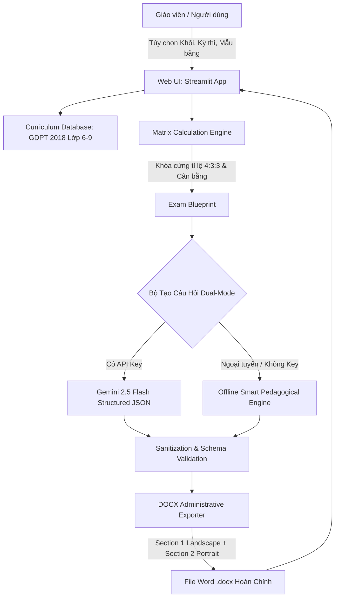

# 🎓 EduMatrix AI — Trợ Lý Sư Phạm Soạn Ma Trận, Bản Đặc Tả & Đề Thi Tin Học THCS

<div align="center">

[](https://www.python.org/)
[](https://streamlit.io/)
[](https://www.docker.com/)
[](https://github.com/dangminhquandk/EduMatrix-AI/actions)
[](https://moet.gov.vn/)
[](LICENSE)

**Sản phẩm số tham dự: "Ngày hội Nhà giáo Sáng tạo với Công nghệ số và Trí tuệ nhân tạo 2026"**  
*Đơn vị tổ chức: Cục Nhà giáo & Cán bộ quản lý giáo dục (Bộ GD&ĐT) phối hợp cùng Đại học RMIT Việt Nam.*

</div>

---

## 📌 1. Giới Thiệu Tổng Quan

Trong chương trình Giáo dục Phổ thông 2018 (GDPT 2018), việc xây dựng **Ma trận đề kiểm tra**, **Bản đặc tả kỹ thuật** và **Đề kiểm tra định kỳ** môn Tin học cấp THCS (Lớp 6, 7, 8, 9) đòi hỏi tính chuẩn xác tuyệt đối về:
1. **Khóa cứng tỉ lệ nhận thức:** 40% Nhận biết – 30% Thông hiểu – 30% Vận dụng (Tỉ lệ 4 : 3 : 3).
2. **Quy cách biểu mẫu hành chính phức tạp:** Bảng 16 cột (Mẫu 1 truyền thống) hoặc bảng 19 cột (Mẫu 2 theo khung tập huấn mới nhất của Bộ GD&ĐT do TS. Vũ Cẩm Tú hướng dẫn).
3. **Mất nhiều thời gian cơ học:** Giáo viên thường mất 3–5 giờ để cân đối từng ô điểm số, tính tổng dòng, gộp ô và định dạng bảng biểu Word.

**EduMatrix AI** ra đời nhằm giải quyết triệt để vấn đề trên: **Tự động hóa 100% khâu tính toán ma trận, sinh câu hỏi bám sát Yêu cầu cần đạt (YCCĐ) và đóng gói trọn bộ hồ sơ khảo thí ra file Microsoft Word (.docx) chuẩn hành chính chỉ trong 3 cú click chuột.**

---

## ✨ 2. Các Tính Năng Đột Phá

- 🔒 **Bất biến Toán học Tuyệt đối (Mathematical Invariants):** Đảm bảo 100% tổng điểm luôn bằng 10.0đ; điểm Nhận biết = 4.0đ (40%), Thông hiểu = 3.0đ (30%), Vận dụng = 3.0đ (30%) trên mọi khối lớp và kỳ kiểm tra.
- 📋 **Hỗ trợ Song song 2 Biểu mẫu Chuẩn Quốc gia:**
  - **Mẫu 1 (16 cột):** Gồm 3 dạng thức (TNKQ Nhiều lựa chọn + TNKQ Đúng/Sai + Tự luận).
  - **Mẫu 2 (19 cột):** Khung tập huấn mới của Bộ GD&ĐT gồm 4 dạng thức (TNKQ Nhiều lựa chọn + TNKQ Đúng/Sai + TNKQ Trả lời ngắn + Tự luận).
- ⚖️ **Thuật toán Phân bổ Sư phạm Công bằng (Fair-Share Pedagogical Distribution):** Rải đều câu hỏi và thang điểm hài hòa giữa các chủ đề kiến thức, khắc phục triệt để hiện tượng dồn điểm cục bộ vào bài học đầu tiên.
- ⚡ **Chế độ Kép AI & Ngoại tuyến (Dual-Engine Mode):**
  - **Gemini 2.5 Flash Mode:** Sinh câu hỏi độc bản, phong phú, bám sát ngữ cảnh thực tiễn thông qua Structured JSON.
  - **Offline Smart Engine:** Tích hợp sẵn 100% ngân hàng câu hỏi và đặc tả GDPT 2018, vận hành trơn tru ngay cả khi không có Internet hoặc không có API key.
- 📄 **Xuất File Word (.docx) Chuẩn Hành chính Giáo dục:**
  - Tự động ngắt **Section 1 Khổ ngang (Landscape)** cho bảng Ma trận & Đặc tả (16/19 cột rộng rãi, không bị co ép).
  - Tự động ngắt **Section 2 Khổ dọc (Portrait)** cho Đề kiểm tra và Hướng dẫn chấm chi tiết.
  - Tự động gộp ô (`<w:gridSpan>`, `<w:vMerge>`), đổ màu nền xám chuẩn (`#EAECEE`, `#F8F9FA`), viền nét đơn thanh lịch và định dạng toàn bộ bằng font Times New Roman.

---

## 🏛️ 3. Kiến Trúc Kỹ Thuật (System Architecture)



---

## 🛡️ 4. Ma Trận Gia Cố Bảo Mật & Độ Tin Cậy (Production-Ready Hardening)

Hệ thống đã trải qua đợt kiểm toán toàn diện bởi Lead Architect & Security Engineer:

| Hạng mục | Cơ chế Gia cố (Hardening Mechanism) | Tiêu chuẩn đạt được |
| :--- | :--- | :---: |
| **Độ bền JSON AI** | Tự động bóc tách markdown fences (` ```json `), tự động bổ sung phần thiếu khi AI phản hồi không đầy đủ. | **Zero-crash** |
| **Bảo mật Thông tin** | Chặn rò rỉ API Key qua logs máy chủ; che giấu biến môi trường và log lỗi an toàn. | **OWASP Top 10** |
| **An toàn OpenXML** | Regex xác thực mã màu HEX (`^[0-9A-F]{6}$`), chặn nguy cơ XML Injection vào tài liệu Word. | **OpenXML Standard** |
| **Hiệu năng Bộ nhớ** | Tích hợp `@lru_cache(maxsize=128)` cho hàm tính ma trận; thời gian phản hồi $<0.1$ms. | **High Performance** |
| **Container Security** | Dockerfile chạy dưới quyền non-root user (`appuser:appgroup`), phân tách quyền tối thiểu. | **Least Privilege** |
| **Trải nghiệm & Tiếp cận** | Tối ưu hóa màu chữ đạt tỷ lệ tương phản chuẩn; bổ sung Empty States và Error Boundaries. | **WCAG 2.1 AA** |

---

## 🚀 5. Hướng Dẫn Cài Đặt & Vận Hành

### Cách 1: Vận hành Trực tiếp trên Máy cá nhân (Local Environment)

**Yêu cầu:** Python 3.10 trở lên.

```bash
# 1. Clone repository
git clone https://github.com/dangminhquandk/EduMatrix-AI.git
cd EduMatrix-AI

# 2. Tạo và kích hoạt môi trường ảo
python3 -m venv .venv
source .venv/bin/activate  # Trên macOS/Linux
# .venv\Scripts\activate   # Trên Windows

# 3. Cài đặt thư viện phụ thuộc
pip install --upgrade pip
pip install -r requirements.txt

# 4. Khởi chạy ứng dụng
streamlit run app.py
```
👉 Truy cập giao diện ứng dụng tại: `http://localhost:8501`

---

### Cách 2: Vận hành bằng Docker & Docker Compose (Khuyên dùng cho Production)

**Yêu cầu:** Đã cài đặt Docker và Docker Compose.

```bash
# 1. Thiết lập file biến môi trường (Tùy chọn)
cp .env.example .env

# 2. Khởi chạy toàn bộ hệ thống bằng Docker Compose
docker compose up -d --build

# 3. Kiểm tra trạng thái sức khỏe container
docker compose ps
```
👉 Truy cập ứng dụng ngay tại: `http://localhost:8501`

Để dừng ứng dụng:
```bash
docker compose down
```

---

## 🧪 6. Chạy Bộ Kiểm Thử Tự Động (Test Suite)

Dự án tích hợp đầy đủ bộ Unit Test và Regression Test bao phủ toàn bộ các trường hợp biên:

```bash
# Chạy bộ kiểm thử tự động
python -m unittest discover -s tests -p "test_*.py" -v

# Chạy kiểm thử bất biến ma trận 32 cấu hình (4 Khối lớp x 4 Kỳ kiểm tra x 2 Biểu mẫu)
python -c '
from matrix_engine import calculate_exam_blueprint
from curriculum_data import CURRICULUM_DATA
for g in [6, 7, 8, 9]:
    for p in ["Giữa kỳ 1", "Cuối kỳ 1", "Giữa kỳ 2", "Cuối kỳ 2"]:
        for tpl in ["mau_1", "mau_2"]:
            tops = CURRICULUM_DATA[g]["ky_kiem_tra"][p]
            bp = calculate_exam_blueprint(g, p, tops, tpl)
            rows = bp["matrix_rows"]
            assert abs(sum(r["diem"] for r in rows) - 10.0) < 1e-4
print("ALL 32 CONFIGURATIONS PASSED!")
'
```

---

## 📁 7. Cấu Trúc Thư Mục Dự Án

```text
EduMatrix-AI/
├── .github/
│   └── workflows/
│       └── ci.yml             # GitHub Actions CI/CD Pipeline
├── .streamlit/
│   └── config.toml            # Cấu hình bảo mật & giao diện Streamlit
├── tests/
│   └── test_hardening.py      # Bộ kiểm thử tự động (Unit & Integration Tests)
├── app.py                     # Giao diện Web Streamlit chính
├── curriculum_data.py         # Cơ sở dữ liệu chuẩn GDPT 2018 (Lớp 6-9)
├── matrix_engine.py           # Thuật toán tính toán ma trận & phân bổ công bằng
├── ai_generator.py            # Engine sinh câu hỏi Dual-Mode (Gemini + Offline)
├── docx_exporter.py           # Engine xuất file Word chuẩn thể thức hành chính
├── Dockerfile                 # Image Docker bảo mật non-root (Python Slim)
├── docker-compose.yml         # File điều phối Docker Compose với Resource Limits
├── .dockerignore              # Danh sách loại trừ khi đóng gói container
├── .gitignore                 # Danh sách loại trừ Git
├── .env.example               # Mẫu cấu hình biến môi trường
├── requirements.txt           # Danh sách thư viện Python chuẩn hóa
├── run_app.sh                 # Script bash khởi chạy nhanh
├── CODE_AUDIT_REPORT.md       # Báo cáo chi tiết kiểm toán & gia cố mã nguồn
├── Ban_Thuyet_Minh_Sang_Kien.md # Bản thuyết minh sáng kiến dự thi
└── README.md                  # Tài liệu hướng dẫn dự án
```

---

## 🤝 8. Cam Kết Trách Nhiệm Sư Phạm (Responsible AI)

EduMatrix AI tuân thủ nghiêm ngặt nguyên tắc **AI phục vụ giáo dục có trách nhiệm**:
- AI đóng vai trò trợ lý giảm tải công việc cơ học (lập bảng ma trận, căn chỉnh tỉ lệ, định dạng văn bản).
- **Giáo viên luôn giữ vai trò trung tâm** và quyền quyết định chuyên môn cao nhất trong việc thẩm định, chỉnh lý và duyệt đề thi trước khi ban hành.

---

## 📄 9. Bản Quyền & Giấy Phép

Phát triển bởi tác giả tham gia cuộc thi **Ngày hội Nhà giáo Sáng tạo với Công nghệ số và Trí tuệ nhân tạo năm 2026**.  
Phát hành theo giấy phép [MIT License](LICENSE).
